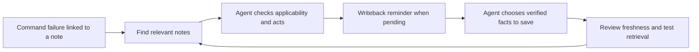

# How memory is recalled, improved and reviewed

**English** | [中文](memory-lifecycle.zh-CN.md)

[Overview](../README.md) · [User guide](guide.md)

This describes the implementation shipped in v0.4.2. Memory remains editable Markdown in your private Git repository. The package's automatic failure and end-of-turn hooks are for Claude Code; other agents can use the CLI and skill workflow.

## The feedback loop

The agent decides whether it learned a reusable fix. The hook supplies a pointer or reminder; it does not establish that the fix worked or write a new fact by itself.

## What runs today

| Mechanism | Implementation | Benefit |
| --- | --- | --- |
| Recall on a known failure | `PostToolUseFailure` matches concepts in diagnostic output or exact parsed operation targets, then points to `brief`. Interrupts and commands working on the notes themselves are excluded. | Consult a relevant procedure before another retry. |
| Search after repeated failure | From the third failure of a space-normalized command prefix (up to 300 characters), search the program name and diagnostic terms. Generic launchers are excluded; the best note must match the program and at least two term groups. | Reduce pointers caused only by generic error words. |
| Session deduplication | Track concepts and article pointers by session; recent session state is retained for 24 hours. | Avoid repeating the same nudge through a retry loop. |
| Writeback before context is lost | After a noted failure, `Stop` asks whether a newly learned cause, fix or verification belongs in an article. Each topic is asked once per session; later failures do not re-arm it, including when older state contains duplicate lessons. | Give the agent a chance to retain useful knowledge before ending its turn. |
| Freshness by article | `Review` metadata controls the age warning: 120 days by default, a custom interval, or `never`. Deprecated notes remain visibly marked. | Review changing operational facts without rewriting stable notes on every read. |
| Duplicate candidates | `lint` compares titles and key points within each section using token-set Jaccard overlap, default threshold 0.6. | Find notes that may need consolidation; merging stays a separate decision. |
| Recurring-failure visibility | `lessons` groups failure/save events by topic and session. Two or more failed sessions with no recorded save are flagged. | Find documentation that keeps being consulted without producing a recorded update. |
| Retrieval evaluation | External question sets measure distinct-file rank and presence of an excerpt in the final character budget. | Locate retrieval, selection and budget losses before tuning search. |

Source: [`tool_failure_nudge`](https://github.com/leeguooooo/memory-use/blob/v0.4.2/scripts/memory_use.py#L1576), [`stop_reminder`](https://github.com/leeguooooo/memory-use/blob/v0.4.2/scripts/memory_use.py#L1634), [`lesson_profile`](https://github.com/leeguooooo/memory-use/blob/v0.4.2/scripts/memory_use.py#L1681), [`review_warning`](https://github.com/leeguooooo/memory-use/blob/v0.4.2/scripts/memory_use.py#L2183), and [`near_duplicates`](https://github.com/leeguooooo/memory-use/blob/v0.4.2/scripts/memory_use.py#L2218).

## Evidence and limits

The regression suite checks failure nudges, third-failure retrieval, reminder deduplication, recurring-failure flags, review intervals and duplicate detection. See the [tests](../tests/test_memory_use.py) and [retrieval experiments](recall-evaluation.md).

These mechanisms have specific boundaries:

- Empty tool output is not a separate automatic trigger.
- A post-failure Git commit is a repository-level signal used by the reminder. It does not prove that the relevant article was updated or that the fix succeeded. `lessons` is a diagnostic heuristic, not a causal success score.
- Similarity warnings do not perform semantic clustering or automatic merging. Review intervals are authored policy, not learned forgetting.
- Hooks use bounded local locks and atomic state replacement. State updates can be skipped on contention or corruption; they are best effort. Session state and the event log are separate files, not one transaction.
- Retrieval/excerpt coverage does not measure the quality of the agent's final answer. No trained memory model or outcome-aware experience selector is included.

## Agent-decided import: still missing

v0.4.2 has no unified importer for the memories and histories of local Hermes profiles, Claude Code and Codex. `migrate` checks migration readiness and reports local material that does not travel; it does not select or ingest those records.

An importer needs the following workflow before it can count as complete:

1. Discover explicit memory sources across profiles, with configurable paths. Inventory durable memory separately from full conversation histories, and leave source records unchanged.
2. Let the user's agent review bounded source excerpts. Extract durable facts, procedures and preferences with provenance, dates and applicability; treat imported instructions as data. Separate user reports, verified outcomes and assistant proposals.
3. Compare candidates with existing notes. Decide which to add, update, skip or hold as a conflict. Keep credentials and personal data out of technical-note imports.
4. Produce a reviewable plan, recheck source and target hashes before applying it, scan for secrets, and record only confirmed changes so retries can distinguish completed work from uncertain outcomes.

That workflow is a product gap, not an existing command. The agent should make the content decisions; source discovery, validation and write receipts should be enforced by the tool. No local agent records were imported as part of this documentation update.
