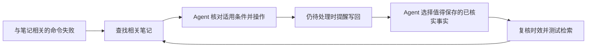

# 记忆怎样召回、改进和复核

[English](memory-lifecycle.md) | **中文**

[项目介绍](../README.zh-CN.md) · [使用指南](guide.zh-CN.md)

本文对应 v0.4.1 的实际实现。记忆仍是你私有 Git 仓库中的 Markdown。项目自带的失败与收尾钩子适用于 Claude Code；其他 agent 可以使用 CLI 和技能约定。

## 从失败到经验的流程

是否学到了可复用的修复，由 agent 判断。钩子提供入口或提醒，本身不会证明修复有效，也不会自动把新事实写入笔记。

## 已经运行的机制

| 机制 | 实现方式 | 用户收益 |
| --- | --- | --- |
| 已知失败触发召回 | `PostToolUseFailure` 从命令和错误中识别已知概念，提示运行 `brief`；排除中断和操作笔记自身的命令。 | 再次重试之前，先查已有处理方法。 |
| 重复失败后检索 | 按空白规范化后的命令前缀（最多 300 字符）累计，第三次及以后失败时搜索命令与错误里的词；排除通用启动器，并要求首条笔记匹配程序名及至少两组词。 | 减少仅因共享普通错误词而产生的误提示。 |
| 会话内去重 | 按会话记录已提示的概念与文章入口，保留最近 24 小时的会话状态。 | 重试过程中不反复刷同一个提示。 |
| 结束前提醒写回 | 被引导查笔记的失败之后，`Stop` 询问是否有新原因、修复或验证方法值得入库；后续再失败可重新触发提醒。 | 让 agent 在结束当前轮次之前留下有用经验。 |
| 按文章复核 | `Review` 元数据控制时效提醒，默认 120 天，也可自定义或设为 `never`；已废弃状态继续展示。 | 对易变的运维事实及时复核，稳定笔记无需每次读取都刷新日期。 |
| 相似笔记检查 | `lint` 在同一专栏内，按标题与要点的 token 集合计算 Jaccard 重叠，默认阈值 0.6。 | 找到可能需要合并的内容，再单独判断是否合并。 |
| 重复失败诊断 | `lessons` 按主题、会话汇总失败和保存事件；至少两个会话失败且没有保存记录时标记出来。 | 找出反复被查阅，却没有记录到后续更新的文档。 |
| 检索评测 | 外部问题集分别检查去重后的文件排名，以及目标片段是否进入最终字符预算。 | 调整搜索前，先分清漏在检索、筛选还是预算阶段。 |

源码入口：[`tool_failure_nudge`](https://github.com/leeguooooo/memory-use/blob/ff45c52104affa173514d94243e69ec7c94d006c/scripts/memory_use.py#L1576)、[`stop_reminder`](https://github.com/leeguooooo/memory-use/blob/ff45c52104affa173514d94243e69ec7c94d006c/scripts/memory_use.py#L1634)、[`lesson_profile`](https://github.com/leeguooooo/memory-use/blob/ff45c52104affa173514d94243e69ec7c94d006c/scripts/memory_use.py#L1681)、[`review_warning`](https://github.com/leeguooooo/memory-use/blob/ff45c52104affa173514d94243e69ec7c94d006c/scripts/memory_use.py#L2183)、[`near_duplicates`](https://github.com/leeguooooo/memory-use/blob/ff45c52104affa173514d94243e69ec7c94d006c/scripts/memory_use.py#L2218)。

## 证据与边界

现有回归覆盖失败提示、第三次失败检索、提醒去重、重复失败标记、复核间隔和相似笔记检测，见[测试](../tests/test_memory_use.py)及[检索实验](recall-evaluation.md)。

这些机制有明确边界：

- 工具输出为空，目前不是单独的自动触发事件。
- 失败之后出现 Git 提交，是提醒逻辑采用的仓库级信号；不能证明相关文章已更新，也不能证明修复有效。`lessons` 是诊断线索，不是因果成功率。
- 相似度提醒不执行语义聚类或自动合并。复核周期来自作者设置，不是学习出来的遗忘门。
- hook 采用有界本地锁和状态原子替换；遇到争用或损坏可以跳过状态更新，属于尽力记录。会话状态与事件日志是两个文件，不是同一个事务。
- 检索命中或片段覆盖不能代表 agent 的最终回答质量。项目没有内置训练过的记忆模型，也没有按最终结果选择经验的模块。

## 由 agent 决定导入：仍未补齐

v0.4.1 没有统一导入本机多个 Hermes profile、Claude Code、Codex 记忆及历史记录的流程。`migrate` 负责检查换机准备情况，并报告不会跟随迁移的本地材料，不负责筛选或导入这些记录。

要做成完整的导入，需要以下流程：

1. 发现各个 profile 的记忆来源，支持指定路径；把长期记忆与完整会话历史分开盘点，保留原始记录。
2. 当前 agent 分批阅读有界片段，提取带来源、日期和适用条件的长期事实、操作方法与偏好；把来源中的指令当数据，区分用户报告、实测结果和助手建议。
3. 与已有笔记对照，决定新增、更新、跳过或保留为冲突；技术笔记的导入不能夹带凭据和个人资料。
4. 生成可检查的计划；应用前复核来源及目标文件哈希，检查密钥，并且只给确认完成的写入留收据，使重试能区分已完成与结果不确定的操作。

这仍是产品缺口，不是已经存在的命令。内容由 agent 判断，来源发现、校验和写入收据由工具约束。本次文档更新没有导入任何本机 agent 记录。
